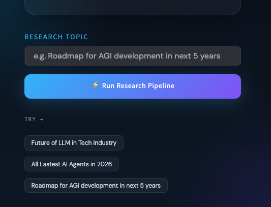

# AtlasSeek

AtlasSeek is a local-first, multi-agent research assistant. Give it a topic and it searches the web, extracts a relevant source, drafts a structured report, and asks a critic to review the result. The Streamlit interface shows each stage and lets you download the report as Markdown.



## How it works

```text
Research topic
      |
      v
Search agent (Tavily, up to 5 results)
      |
      v
Reader agent (selects a result and extracts article text)
      |
      v
Writer chain (introduction, findings, conclusion, sources)
      |
      v
Critic chain (score, strengths, improvements, verdict)
      |
      v
Report and review in the Streamlit app
```

The search and reader agents use an Ollama model; the writer and critic use the same model through LangChain. Article extraction tries Trafilatura first, then Readability and Beautiful Soup as fallbacks.

## Requirements

- Python 3.11 or newer
- [Ollama](https://ollama.com/download), running locally
- An Ollama model that supports tool calling (the default is `qwen2.5-coder:latest`)
- A [Tavily API key](https://tavily.com) for web search

The language model runs through Ollama. You do not need an OpenAI API key.

## Quick start

### 1. Get the code and create an environment

```bash
git clone https://github.com/rohan9521/AtlasSeek.git
cd AtlasSeek
python3 -m venv .venv
source .venv/bin/activate
```

On Windows PowerShell, activate the environment with:

```powershell
.venv\Scripts\Activate.ps1
```

### 2. Install the Python dependencies

```bash
python -m pip install --upgrade pip
python -m pip install -r requirements.txt
```

### 3. Start Ollama and download the model

If Ollama is not already running, start it in a separate terminal:

```bash
ollama serve
```

Then download the default model:

```bash
ollama pull qwen2.5-coder:latest
```

### 4. Configure Tavily

Copy the example environment file and add your Tavily key:

```bash
cp .env.example .env
```

Set `TAVILY_API_KEY` in `.env`. You can also set `OLLAMA_MODEL` or `OLLAMA_BASE_URL` there if you use a different tool-capable model or Ollama server. Keep `.env` private; it is excluded from Git.

### 5. Launch AtlasSeek

```bash
streamlit run app.py
```

Open the local URL printed by Streamlit (usually <http://localhost:8501>).

## Walkthrough

1. Enter a focused question or research topic in **Research Topic**. For example: `How is AI changing software engineering?`
2. Select **Run Research Pipeline**. The pipeline panel shows progress through Search Agent, Reader Agent, Writer Chain, and Critic Chain.
3. Review the search results and extracted source text in the expandable raw-output sections.
4. Read the generated report, organized into an introduction, key findings, conclusion, and sources.
5. Check the critic's score, strengths, improvement suggestions, and verdict.
6. Select **Download Report (.md)** to save the report as a Markdown file.

Research uses live web search and external article pages, so the results depend on network availability, source accessibility, and your Tavily account limits.

## Run from the command line

The optional script entry point is:

```bash
python main.py
```

It runs the topic currently assigned to `topic` in `main.py`. For interactive topic entry and report download, use the Streamlit app instead.

## Configuration

| Variable | Required | Default | Description |
| --- | --- | --- | --- |
| `TAVILY_API_KEY` | Yes | — | API key used by the web-search tool |
| `OLLAMA_MODEL` | No | `qwen2.5-coder:latest` | Ollama model used by all four stages |
| `OLLAMA_BASE_URL` | No | `http://localhost:11434` | Ollama server URL |

## Project layout

```text
.
├── app.py                  # Streamlit interface and interactive workflow
├── main.py                 # Script entry point with an example topic
├── requirements.txt        # Python dependencies
├── .env.example            # Safe configuration template
├── docs/
│   └── images/
│       └── atlas-seek-home.png
└── src/
    ├── agents/
    │   └── agents.py       # Search/reader agents and writer/critic chains
    ├── pipelines/
    │   └── pipeline.py     # Reusable research pipeline
    └── tools/
        └── tools.py        # Tavily search and web-page extraction tools
```

## Notes and limitations

- The reader selects a relevant URL from search results and extracts content from that page; it does not independently verify every claim or source.
- Search results and scraped text are context for the model, not a guarantee of factual accuracy. Verify important claims and citations before relying on a report.
- Some websites block automated requests or do not expose readable article text.
- The default Ollama model must support tool calling for the search and reader agents to work.

## Technology

| Component | Role |
| --- | --- |
| [LangChain](https://www.langchain.com/) | Agent tools and report-generation chains |
| [Ollama](https://ollama.com/) | Local language model runtime |
| [Streamlit](https://streamlit.io/) | Interactive web interface |
| [Tavily](https://tavily.com/) | Web search |
| Trafilatura, Readability, Beautiful Soup | Web-page text extraction |

## License

AtlasSeek is distributed under the MIT License. See [LICENSE](LICENSE).
